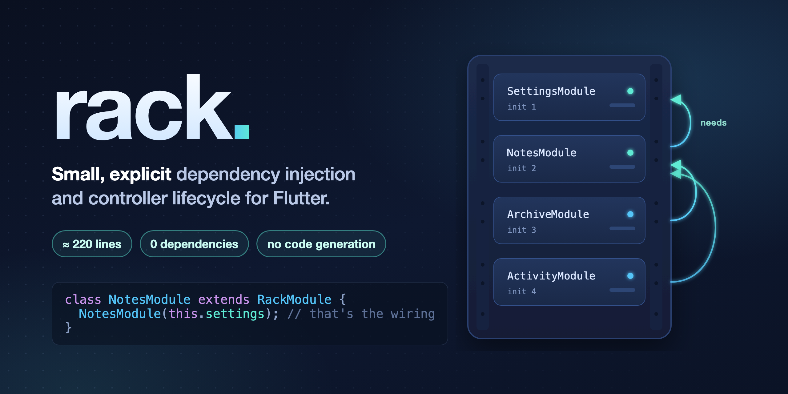
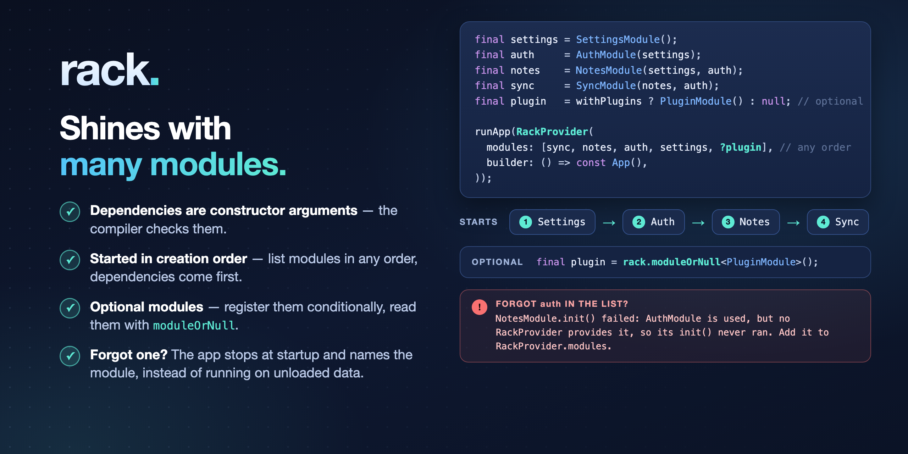

# rack



Small, explicit dependency injection and controller lifecycle for Flutter. No code generation, no dependencies.

- **Modules** hold your stores and services. A module's dependencies are its constructor arguments.
- **Controllers** belong to a screen. rack creates one when the screen mounts and disposes it when the screen goes away.

## Install

```sh
flutter pub add rack
```

## Usage

```dart
class AppModule extends RackModule {
  late final notesStore = use(NotesStore());

  // Optional: runs before the app is shown.
  @override
  Future<void> init() async {
    await notesStore.load();
  }
}

void main() {
  runApp(
    RackProvider(
      modules: [AppModule()],
      loading: const SplashScreen(),
      builder: () => const NotesApp(),
    ),
  );
}

class NotesController {
  NotesController(this.notesStore);
  final NotesStore notesStore;

  void add(String text) {
    notesStore.add(text);
  }
}

class NotesScreen extends RackWidget<NotesController> {
  const NotesScreen({super.key});

  @override
  NotesController create(Rack rack) {
    return NotesController(rack.module<AppModule>().notesStore);
  }

  @override
  Widget buildContent(BuildContext context, NotesController controller) {
    return NotesView(controller: controller);
  }
}
```

`use()` registers a service so it is disposed with the module, `late final` creates it on first access. If a controller implements `Disposable`, it is disposed with its screen.

## Multiple modules



```dart
final settings = SettingsModule();
final auth = AuthModule(settings);
final notes = NotesModule(settings, auth);

RackProvider(modules: [notes, auth, settings], builder: () => const App());
```

Modules are initialized in the order they were created, so a module's dependencies are always ready before it. The order of the list doesn't matter. If a module is used but not listed, the app stops at startup and names it.

Modules can be optional: add them conditionally and read them with `rack.moduleOrNull<T>()`.

## Reactive state

rack is not a state management library. Use signals, `ValueNotifier` or streams in your stores and wrap the widgets that read them in the matching builder (`SignalBuilder`, `ValueListenableBuilder`, `StreamBuilder`).

With [signals](https://pub.dev/packages/signals_flutter), the store holds the signal and the screen reads it inside a `SignalBuilder`:

```dart
class NotesStore implements Disposable {
  final notes = signal<List<String>>([]);

  Future<void> load() async {
    notes.value = await loadNotesFromDisk();
  }

  void add(String text) {
    notes.value = [...notes.value, text];
  }

  @override
  void dispose() {
    notes.dispose();
  }
}

class NotesScreen extends RackWidget<NotesController> {
  const NotesScreen({super.key});

  @override
  NotesController create(Rack rack) {
    return NotesController(rack.module<AppModule>().notesStore);
  }

  @override
  Widget buildContent(BuildContext context, NotesController controller) {
    return Scaffold(
      appBar: AppBar(title: const Text('Notes')), // never rebuilds
      body: SignalBuilder(
        // Rebuilds whenever a signal read in here changes.
        builder: (context) {
          final notes = controller.notesStore.notes.value;
          return ListView(
            children: [
              for (final note in notes) ListTile(title: Text(note)),
            ],
          );
        },
      ),
      floatingActionButton: FloatingActionButton(
        onPressed: () => controller.add('New note'),
        child: const Icon(Icons.add),
      ),
    );
  }
}
```

A signal read outside a `SignalBuilder` is not tracked, and the UI silently stays stale. For child widgets that read signals, extend `SignalWidget` instead of `StatelessWidget`. More in the [guide](doc/guide.md#using-rack-with-signals).

## More

- [Guide](doc/guide.md): async init, loading and error states, screen-scoped modules, testing, using rack with signals
- [Example app](example/lib/main.dart)

## License

MIT
